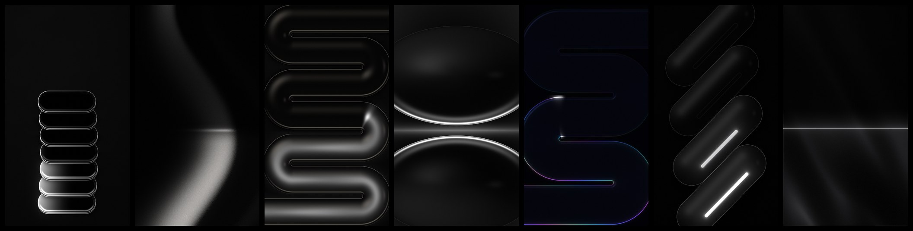

# Your Average Clock

A calm, full-screen focus timer built for a vertical 4K monitor. The background is the progress bar: every background is a real-time glass scene rendered on the GPU, and it visibly changes as your session runs.



| Background | How it shows progress |
| --- | --- |
| **Glass Capsules** | Seven frosted slabs, one per seventh of the session. Each one's light recedes and goes dark, top first. |
| **Sand Dune** | Fine sand under low light. Dusk creeps down the dune, edged by a line of last light. |
| **Liquid Glass** | A folded smoked-glass tube. The light inside drains toward the end, with a bright meniscus. |
| **Mirror Domes** | Two glass domes close the gap of light between them and meet when time is up. |
| **Midnight Folds** | Navy glass bands. Their iridescent edge light runs out along the fold. |
| **Glass Links** | A chain of dark glass. Each rod of light is a quarter of the session. |
| **Graphite Satin** | An example *image* background with the built-in "descending dusk" effect. |

Everything renders at native resolution (up to 2160×3840), so there are no blurry wallpapers. It adapts to any screen size or orientation.

## Use it

```bash
npm install
npm run dev        # http://localhost:5173
npm run build      # static site in dist/
npm run preview    # serve the production build
```

| Key | Action |
| --- | --- |
| Space | Start / pause (or tap anywhere while running) |
| B / Shift+B | Next / previous background |
| F | Full screen |

- Presets: 5, 15, 25, 45, 60 min. **Custom** takes hours, minutes and seconds (e.g. 3 hr 40 sec).
- While the timer runs, everything fades except the time and the background.
- The background and last duration are remembered.
- On a slower GPU, open with `?scale=0.75` (remembered) to render at 75% resolution.

### Deploy to GitHub Pages

The repo ships with `.github/workflows/deploy.yml`. In the repo's **Settings → Pages**, set **Source** to **GitHub Actions**. Every push to `main` then publishes the site. The build uses relative paths, so it works from any sub-path.

## Project structure

```
src/
  main.ts                 app wiring: timer ↔ UI ↔ renderer
  core/
    renderer.ts           WebGL2 runner: compiles a background, feeds uniforms, eases progress
    common.glsl           shared shader helpers (SDFs, noise, studio reflections, serpentine path)
    image.frag            default progress effect for image backgrounds
    timer.ts              wall-clock countdown (accurate even in background tabs)
    chime.ts, settings.ts
  ui/picker.ts            background sheet with live-rendered thumbnails
  styles/app.css          glass UI, sized in "design units" so it scales with the screen
  backgrounds/
    registry.ts           auto-discovers every folder below
    types.ts              BackgroundDefinition contract
    glass-capsules/       index.ts + capsules.frag
    sand-dune/            index.ts + dune.frag
    …                     one folder per background
docs/background-template/ a starting point for new backgrounds
```

## Adding a background

Each background is one folder. The registry picks up `src/backgrounds/*/index.ts` automatically, so **no app code changes are needed**.

1. Copy `docs/background-template/` to `src/backgrounds/<your-id>/`.
2. Edit `index.ts`: `id`, `name`, `description`, `order`, and `layout.timeY` (where the digits sit, 0–1 of screen height).
3. Write `scene()` in the `.frag` file and restart `npm run dev`.

### Shader backgrounds

```glsl
#include common

vec3 scene(vec2 p, float px) {
  // p:  design space. Portrait 9:16 frame, width = 1, origin at the centre, +y down.
  //     (x ∈ [-0.5, 0.5], y ∈ [-0.89, 0.89]; the frame is fitted to any screen)
  // px: size of one device pixel in those units. Use it for crisp anti-aliasing.
  return vec3(0.0);
}
```

| Uniform | Meaning |
| --- | --- |
| `u_remaining` | 1 → 0 over the session (eased, so resets animate smoothly) |
| `u_elapsed` | 0 → 1 (`1 - u_remaining`) |
| `u_running` | 0 or 1 (eased). Use it for subtle motion only while focusing |
| `u_time` | seconds since load |
| `u_accent` | accent colour (RGB 0–1) |

Useful helpers in `common.glsl`: `sdStadium`, `sdRoundBox`, `fillAA`, `lineAA`, `fbm`, `vnoise`, `studioEnv` (reflections for glass), `fresnel`, `serpentine` (distance + arclength along a folded path, which is handy for "light travelling along a shape").

Guidelines that keep the set consistent:

- Make progress **obvious at a glance from across the room**, and beautiful. Light leaving the scene works best.
- Keep the zone around `layout.timeY` calm, or raise `layout.scrim`.
- Stay monochrome and use `u_accent` for the light that carries the progress.
- Size details in design units (or multiples of `px`) so they look the same at 1080p and 4K.

### Image backgrounds

Put an image (ideally ≥ 2160×3840) in a folder with an `index.ts`:

```ts
export default {
  id: 'my-photo',
  name: 'My Photo',
  kind: 'image',
  src: new URL('./photo.jpg', import.meta.url).href,
  layout: { timeY: 0.2 },
} satisfies BackgroundDefinition;
```

Progress is drawn by `src/core/image.frag` (a soft dusk descending with a fine light line). Add a `fragment` to the definition to give one image its own effect. Only commit images you have the rights to publish.

## Tech

Vite + TypeScript, no framework, no runtime dependencies. WebGL2 (every current browser). MIT licensed.
